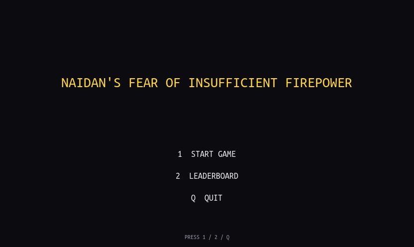
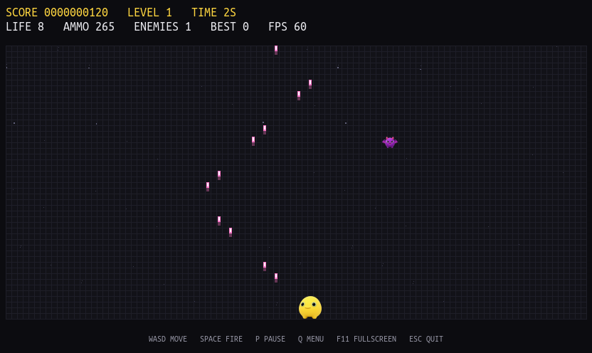
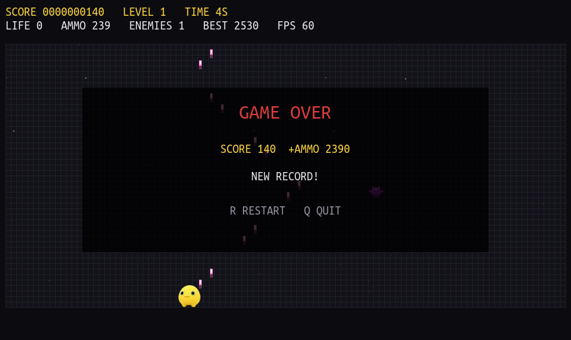

# 奶蛋的火力不足恐惧症 v1.8

> Naidan's Fear of Insufficient Firepower

一款纵向射击小游戏：操控奶蛋在有限生命与弹药下躲避敌机、击落敌人、尽量拿高分。
C++17 编写，SDL3 渲染，**单文件发布**（运行库、字体、精灵全部内嵌，不需要 DLL 和资源目录）。



---

## 快速开始

从 [Releases](https://github.com/Wang-yifan666/Thunder_fighter_jet/releases) 下载 `Naidan.exe`，
双击即可运行。系统要求：Windows 10 / 11（64 位）。

### 关于"Windows 已保护你的电脑 / 未知发布者"

安装包和 exe **目前没有代码签名**（证书要花钱，作者是个人项目）。没有签名时：

- **SmartScreen** 会对每个新文件先拦一次（提示"未知发布者"）；
- 个别**杀毒软件**会对"未签名的安装包"误报，尤其是刚发布、下载量还很少的时候。

确认来源是本仓库后，在提示框点 **更多信息 → 仍要运行** 即可。想更稳妥可以自己校验——
每个 Release 都附了 `SHA256SUMS.txt`：

```powershell
Get-FileHash .\Naidan-1.8-setup.exe -Algorithm SHA256
# 和 SHA256SUMS.txt 里对应那一行对一下
```

真正消除提示只有一条路：给 exe 和安装包做 **Authenticode 代码签名**
（`tools/build_installer.ps1 -Thumbprint <证书指纹>` 已经接好，签名工具取 Windows SDK 的 signtool）。

### 新手教程

主菜单按 `3` 进入，一路走完：移动 → 开火 → 击落两只小怪（必须真的打掉，自己漏下去不算）→ 一个一个认识四种补给 → **真升一级**（顶部 LEVEL 从 1 变 2）→ 一页机制说明。
中途按 `Q` 随时跳过。**跳过不算通关**：只有完整走完才会解锁鲨鱼罩装扮。

教程里不会掉血、不刷波、不结算，怎么试都不会死。

### 玩法说明（游戏内 `4`）

主菜单按 `4` 有一页说明，讲清楚：

- **弹药**：击落敌机 +5 发，每升 1 级再 +10 发，打光就打不出子弹
- **生命**：撞到敌机掉 1 条命，之后 1 秒无敌
- **升级**：每 10 秒升 1 级（第 1 级只等 5 秒），敌人更快更密
- **精英**：9 级起出现，4×3 格、2 血、2.5 倍分数、+8 发弹药
- **护盾怪**：6 级起小怪有概率带盾，先破盾再补一发
- **四种补给**：红 血包 / 黄 弹药包 / 蓝 护盾包 / 紫 火力包

### 操作

| 按键 | 功能 |
|---|---|
| `W` `A` `S` `D` | 移动 |
| `Space` | 开火 |
| `P` | 暂停（按下触发，长按不重复） |
| `Q` | 主菜单退出 / 游戏中回主菜单 / 结算界面退出 |
| `R` | 结算界面直接同难度再来一局 |
| `F` | 主菜单切换作弊模式 |
| `F11` | 全屏 |
| `Esc` | 直接退出程序 |

---

## 游戏内容



### 玩法

- 敌机从顶部成批落下，被打中即消灭；从底部漏掉会重新排队再来
- 每只敌机速度随机，敌机之间**不会互相重叠**（速度快的会跟在慢的后面排队）
- **每 2 帧一发子弹**（约 31 发/秒），击落敌机补充 5 发；每 10 秒升一级，敌人更快更密
- 撞到敌机会掉血，掉血后有 1 秒无敌时间；身上有护盾时先破盾
- 后期场上 + 排队的小怪超过 500 只后，每次刷怪会多放几只（上限 +3），
  免得全挤在看不见的队列里、场上反而变稀

### 敌机种类

| 种类 | 体积 | 血量 | 分数 | 弹药 | 出现条件 |
|---|---|---|---|---|---|
| 小怪（紫色小恶魔） | 3×2 格 | 1 | 100 | +5 | 一直都有 |
| 精英（橙色机械） | 4×3 格 | 2 | 250（2.5 倍） | +8 | 9 级起按概率，最高 60% |

- 精英出现概率按指数饱和拟合：`p(L) = cap × (1 − e^(−(L−8)/15))`，
  9 级起步、40 级过半、100 级前后顶到上限，**上限随难度**：简单 40% / 普通 60% / 困难 75%
- **护盾**：精英有 50% 概率自带护盾；普通小怪从 6 级起也有
  10% / 15% / 20%（简单/普通/困难）的概率带盾。
  带盾的怪要先破盾、再补一发子弹（精英则是破盾 + 两发，共三下）
- 敌人护盾被打破后有 **20 帧无敌**：期间子弹**穿过**（不消耗），敌人闪烁——
  所以"打三下"是有节奏的，不是连点三下

### 玩家护盾

- **护盾包**拾取后获得一层护盾（**最多一层**，重复拾取只加 50 分）
- 撞击时先破盾：不掉血，进入和受伤相同的 1 秒无敌
- 破盾瞬间放出**冲击波**：半径 14 格内每只敌机吃 1 点伤害（小怪必死、精英掉 1 血、顺手破别人的盾）
- 冲击波是护盾比血包值钱的地方——它救的是"被围住"的场，而不只是多一条命

### 掉落物

击毁敌机有概率掉落，难度越低补给越慷慨：

| 难度 | 血包 | 弹药包 | 护盾包 | 火力包 | 合计 |
|---|---|---|---|---|---|
| 简单 | 4% | 4% | 3% | 2% | 13% |
| 普通 | 3% | 3% | 2% | 1% | 9% |
| 困难 | 2% | 2% | 2% | 1% | 7% |

- **血包**回复 1 点生命（无上限）
- **弹药包**补充 50 发子弹
- **护盾包**给一层护盾（见上）
- **火力包**让接下来 **15 秒**三路同时开火（x−1 / x / x+1），**只消耗 1 发弹药**；
  重复拾取刷新时长，不叠加
- 掉落物每 16 帧下落 1 格，约 12 秒穿过全屏
- 掉落物**不会叠在一起**：落点被占时向左右两侧各找几个身位，实在挤不下这次就不掉
- **拾取判定用"视觉身体"而不是伤害命中框**：精灵画的是 4 行高，
  看到身体压住道具就能捡到；受伤仍按 1 行判定，两者分开互不影响

### 结算



本局得分 = 游戏内得分 + 剩余弹药 × 10，自动写入本地排行榜 TOP 5。

**存档位置**（按顺序决定）：

1. 环境变量 `NAIDAN_DATA_DIR`（显式指定，方便把存档放到别处）
2. exe 同目录可写 → 写在那里（便携模式，绿色版直接带着存档走）
3. exe 上一级已有 `highscore.txt` → 兼容更早的目录布局
4. 以上都不行（例如装进 `Program Files`）→ `%APPDATA%\Naidan\highscore.txt`

第 4 条是安装版的关键：程序从不往没有写权限的目录里硬写，
否则成绩会静默丢失（或被 UAC 虚拟化重定向到别处，看起来保存了其实没有）。

### 作弊模式

默认**关闭**，正常游玩时数字键完全无效，不会误触。

在主菜单按一次 `F` 打开（界面会短暂提示 `CHEAT MODE: ON`，随后自动消失），
进入游戏后数字键才生效。再按一次 `F` 关闭。

| 键 | 功能 | 键 | 功能 |
|---|---|---|---|
| `1` | 上帝模式 | `2` | 自杀 |
| `3` | 加子弹 +100 | `4` | 加分 +1000 |
| `5` | 无敌开关 | `6` | 增加生命 |
| `7` | 秒杀全屏敌人 | `8` | 清空敌人 |
| `9` | 强制升级 | | |

---

## 构建

### 依赖

- C++17
- CMake ≥ 3.20
- Windows x64 + MinGW-w64（也支持 MSVC）
- vcpkg，需要 `sdl3`、`sdl3-ttf`、`gtest`

```powershell
vcpkg install sdl3:x64-mingw-static sdl3-ttf:x64-mingw-static gtest:x64-mingw-static
```

### 编译与测试

```powershell
cmake -S . -B build -G "MinGW Makefiles" `
      -DCMAKE_BUILD_TYPE=Release `
      -DCMAKE_TOOLCHAIN_FILE=$env:VCPKG_ROOT/scripts/buildsystems/vcpkg.cmake `
      -DVCPKG_TARGET_TRIPLET=x64-mingw-static
cmake --build build
ctest --test-dir build --output-on-failure
```

产物：`build/Naidan.exe`（完全静态链接）。

### 生成安装包

需要 [Inno Setup 6](https://jrsoftware.org/isdl.php)（`winget install JRSoftware.InnoSetup`）：

```powershell
pwsh tools/build_installer.ps1          # 产物在 build/installer/
```

安装包特性：每用户安装到 `%LOCALAPPDATA%\Programs\Naidan`（不需要管理员权限）、
开始菜单快捷方式、可选桌面图标、自带卸载程序、中英双语界面。
简体中文语言包在 `packaging/languages/ChineseSimplified.isl`，随仓库分发。

- SDL3 缺失时配置阶段直接报错（SDL3 现在是必需依赖）
- SDL3_ttf 缺失或字体文件缺失时，自动回退到内置 5×7 点阵字体
- 需要调试输出时加 `-DTHUNDER_SDL_CONSOLE=ON`，改回控制台子系统

### 命令行参数

| 参数 | 说明 |
|---|---|
| `--frames N` | 跑 N 帧后退出（无头冒烟用） |
| `--demo` | 注入脚本化输入：菜单 → 游戏 → 结算 |
| `--screenshot PATH` | 把最后一帧导出为原始 RGBA（配合 `--frames`，用于生成文档截图） |
| `--seed N` | 固定随机种子，让 `--demo` 场景完全可复现（截图与冒烟用） |
| `--no-vsync` | 关闭垂直同步 |
| `--max-fps N` | 限帧（配合 `--no-vsync`） |
| `--help` | 帮助 |

无头冒烟（GUI 子系统程序需要重定向后等待退出）：

```powershell
$env:SDL_VIDEODRIVER = 'dummy'
Start-Process .\build\Naidan.exe -ArgumentList '--frames','300','--demo' `
              -RedirectStandardOutput smoke.txt -Wait
```

---

## 项目结构

```
Thunder_fighter_jet/
├── inc/
│   ├── game/                  # 平台无关的游戏逻辑（thunder_logic）
│   │   ├── game_config.h      # 全部数值常量
│   │   ├── game_info.h        # 产品名与版本号（唯一来源）
│   │   ├── game_types.h       # 难度 / 掉落物种类
│   │   ├── enemy.h            # 敌机数据
│   │   ├── game_world.h       # 对局状态与更新
│   │   ├── game_session.h     # 非阻塞流程状态机
│   │   ├── input_state.h      # 输入快照 / 边沿检测
│   │   ├── world_snapshot.h   # 世界只读快照
│   │   ├── session_snapshot.h # 会话只读快照
│   │   ├── highscore.h        # 排行榜规则
│   │   └── score_store.h      # 分数存储接口
│   ├── io/                    # 文件存取（thunder_io）
│   └── view/                  # 平台无关的场景布局与精灵元数据
├── src/
│   ├── game/                  # thunder_logic 实现
│   ├── io/                    # thunder_io 实现
│   ├── sdl/                   # SDL3 前端（唯一的前端）
│   └── app.rc.in              # Windows 资源模板（图标 + 版本信息）
├── tests/                     # GoogleTest 回归测试
├── tools/
│   ├── bake_sprites.py        # PNG -> 内嵌 RGBA 数据
│   ├── make_screenshots.py    # 生成 README 截图
│   └── build_installer.ps1    # 生成 Inno Setup 安装包
├── packaging/                 # 安装包脚本与载荷（README/许可/中文语言包）
├── assets/
│   ├── fonts/                 # Ubuntu Mono（构建时内嵌）
│   ├── icons/                 # 应用图标
│   ├── screenshots/           # 文档截图（由工具生成）
│   └── sprites/               # 精灵母版与烘焙产物
└── docx/flowchart.md          # 运行流程图
```

### 分层约定

```
GameSession（流程状态机：菜单 → 难度 → 游戏 → 结算）
      ↓ InputState / dt 注入
GameWorld（全部可变对局状态，Tick 推进）
      ↓ WorldSnapshot / SessionSnapshot（只读）
SDL 前端（只读快照，负责绘制与输入采集）
```

- **逻辑层与布局层都不认识 SDL / windows.h / 文件系统 / 系统时钟**
  —— 由 `tests/check_isolation.cmake` 在 ctest 里强制检查
- 时间通过 `Tick(input, dt)` 注入，暂停时前端直接不调用 `Tick`
- 存档通过 `ScoreStore` 接口注入，逻辑层不碰文件
- **格子坐标到像素的换算集中在 `inc/view/scene_layout.h`**：
  `PlayerRect` / `EnemyRect` / `PickupRect` / `BulletRect` 定义了每个精灵的锚点
  （玩家底边对齐、敌机与判定等大、子弹格子居中）。SDL 后端只负责"把算好的
  矩形画出来"。移植到 Android 等新平台时，这一层可以直接复用。

### 素材与烘焙

位图精灵和字体一样在**构建时**嵌入 exe，发布不依赖任何外部文件：

```text
assets/sprites/<name>.png          美术母版（透明底）
assets/sprites/<name>_<w>x<h>.rgba 烘焙产物（构建时嵌入）
tools/bake_sprites.py              转换脚本（仅用 Python 标准库）
```

改素材后重跑：

```powershell
python tools/bake_sprites.py     # 按脚本内登记的尺寸烘焙全部
python tools/make_screenshots.py # 重新生成 README 截图
```

部分素材是从纯黑底抠出来的，边缘像素被 alpha 压黑过。烘焙脚本会自动测量
边缘亮度比，低于阈值时做一次反预乘还原（已修复过的母版登记在 `PREFIXED` 里，
不会重复处理）。

---

## 帧率说明

- 游戏逻辑固定 **16ms 一步**（约 62.5 步/秒），渲染帧率与之解耦
- 默认开启垂直同步：窗口模式经 DWM 合成通常锁在 ~60 FPS；`F11` 全屏后跟随显示器刷新率
- 需要不限帧可加 `--no-vsync`（实测约 9000 FPS，仅用于测试），并用 `--max-fps N` 限制发热
- 渲染帧率再高，画面更新的节奏仍由逻辑步长决定

---

## 版本记录

- **v1.8**
  - 射速改为每 2 帧一发（原每帧一发）；"打两下"从此才有意义
  - 新增**精英敌机**：4×3 格、2 血、2.5 倍分数、+8 弹药，9 级起按指数曲线出现
  - 敌人可带**护盾**：精英 50%，普通小怪 6 级起按难度随机（10/15/20%）；
    破盾后 20 帧无敌，期间子弹穿过并闪烁
  - 新增**玩家护盾**：护盾包拾取，破盾时放半径 14 格的冲击波
  - 新增**火力强化包**：15 秒三路开火、只消耗 1 发弹药
  - 掉落率重分为四种道具；后期限流：小怪超过 500 只时每次多刷几只
  - 安装包补全版本资源（FileVersion/ProductVersion/公司/版权），
    构建脚本接入代码签名钩子（`-Thumbprint`）
- **v1.7**
  - 删除终端（FTXUI）前端，产品改名 Naidan，可执行文件为 `Naidan.exe`
  - 玩家 / 敌机 / 血包 / 弹药包全部使用位图精灵，构建时内嵌
  - 敌机命中框改为 3×2 格，与精灵等大；敌机之间不再重叠
  - 新增掉落物系统（血包 + 弹药包），掉落率随难度变化
  - 拾取判定与伤害判定分离（按视觉身体拾取）
  - 作弊模式默认关闭，主菜单按 `F` 切换
  - 主菜单退出改为 `Q`
  - exe 内置图标与中英双语版本信息
  - 抽出平台无关的 `inc/view/scene_layout.h`（布局与精灵锚点），
    为移植预留接口；`--seed` 让演示与截图完全可复现
  - 存档位置改为"便携优先、不可写时退到 `%APPDATA%`"；文件改二进制写入，
    `highscore.txt` 不再反复弄脏仓库
- **v1.6** 逻辑与平台分离（`thunder_logic` / `thunder_io`）、新增 SDL3 前端、
  引入 GoogleTest 回归测试与隔离检查
- **v1.5** 难度选择、主菜单排行榜
- **v1.4** 主菜单、上帝模式、状态机与单元测试
- **v1.3** 结算后重新开始

## License

[MIT](LICENSE)

内嵌的 Ubuntu Mono 字体使用
[Ubuntu Font Licence 1.0](assets/fonts/LICENSE-Ubuntu-Font-Licence-1.0.txt)。
