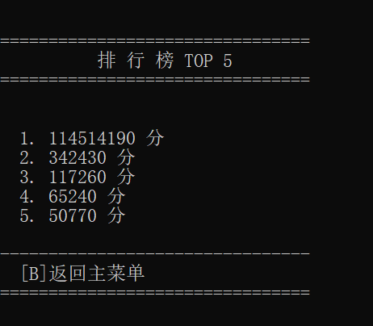
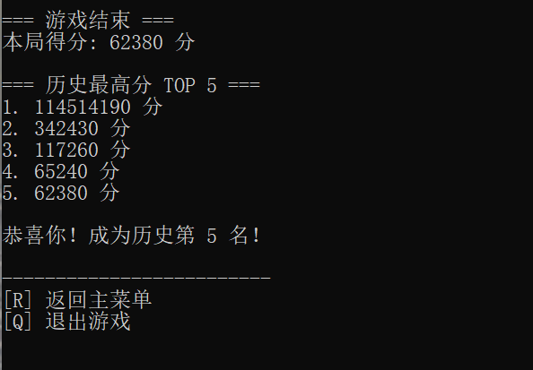

# 奶蛋的火力不足恐惧症 v1.6

## 项目简介

**奶蛋的火力不足恐惧症（Naidan's Fear of Insufficient Firepower）** 是一款纵向射击游戏：玩家操控奶蛋在有限生命与弹药条件下躲避敌人、发射子弹击败敌机，尽可能获得更高分数。

目前有两个前端：

- **终端版**（FTXUI）：原有版本，玩法与界面保持不变；
- **SDL3 图形版**：最小可玩版本，使用同一套游戏逻辑。

---

## 编译与运行

### 编译环境

- C++17
- Windows x64
- MinGW-w64 + CMake
- vcpkg（`ftxui`、`gtest`）
- SDL3（可选，仅图形版需要）

### 构建终端版

```powershell
cmake -S . -B build -G "MinGW Makefiles" `
      -DCMAKE_TOOLCHAIN_FILE=<vcpkg>/scripts/buildsystems/vcpkg.cmake `
      -DVCPKG_TARGET_TRIPLET=x64-mingw-static
cmake --build build
```

产物：

```
build/Thunder_fighter_jet.exe          # 动态链接
build/Thunder_fighter_jet_static.exe   # 静态链接，可直接运行
```

### 运行测试

```powershell
ctest --test-dir build --output-on-failure
```

测试覆盖游戏世界（重置 / 边界 / 子弹 / 无敌 / 升级 / 计分）、会话流程、排行榜规则与终端字符网格。

### 构建 SDL3 图形版（可选）

先安装 SDL3（与 ftxui / gtest 使用同一个 triplet）：

```powershell
vcpkg install sdl3:x64-mingw-static
```

字体（可选，推荐）：安装 SDL3_ttf 后 HUD 与菜单使用 Ubuntu Mono。

```powershell
vcpkg install sdl3-ttf:x64-mingw-static
```

未安装 SDL3_ttf 或运行时找不到 `assets/fonts/UbuntuMono-Regular.ttf` 时，
SDL 版会自动回退到内置 5×7 点阵字体，不影响运行。

之后的构建命令与终端版完全相同，配置阶段会自动启用 SDL 目标：

```powershell
cmake -S . -B build -G "MinGW Makefiles" `
      -DCMAKE_TOOLCHAIN_FILE=<vcpkg>/scripts/buildsystems/vcpkg.cmake `
      -DVCPKG_TARGET_TRIPLET=x64-mingw-static
cmake --build build
```

产物：`build/Thunder_fighter_jet_sdl.exe`。

- 未找到 SDL3 时，配置阶段会提示并自动跳过该目标，终端版不受影响；
- 若 SDL3 不在 vcpkg 中，可用 `-DCMAKE_PREFIX_PATH=<SDL3 安装目录>` 指定；
- 窗口可缩放（逻辑分辨率 832×496，缩放时保持比例并留黑边），`F11` 切换全屏；
- **单文件发布**：SDL 版完全静态链接（运行库、SDL3、SDL3_ttf 均静态），
  Ubuntu Mono 字体在构建时嵌入 exe；发布只需 `Thunder_fighter_jet_sdl.exe`，
  不需要 DLL，也不需要附带 `assets/` 目录；
- 图形版是 GUI 子系统程序：双击启动不会额外弹出控制台窗口；
- 需要看调试输出时用 `-DTHUNDER_SDL_CONSOLE=ON` 重新配置，改回控制台子系统；
- 命令行参数：`--help`、`--frames N`（跑 N 帧后退出）、`--demo`（脚本化输入）、
  `--no-vsync`（关闭垂直同步）、`--max-fps N`（配合 `--no-vsync` 限帧）。

### 素材与烘焙（SDL 版）

位图精灵同样在构建时嵌入 exe，与字体一样不依赖运行时文件：

```text
assets/sprites/player.png       美术母版（透明底、内容居中正方形）
assets/sprites/player_32.rgba   烘焙产物（32×32 原始 RGBA，构建时嵌入）
assets/sprites/enemy_24x16.rgba 敌机（3×2 格，与命中框等大）
assets/sprites/health_24x24.rgba 血包（3×3 格，与判定等大）
assets/sprites/ammo_24x24.rgba  弹药包（3×3 格，与判定等大）
tools/bake_sprites.py           PNG -> .rgba 转换脚本（仅用标准库）
```

改动素材后重跑一次：

```powershell
python tools/bake_sprites.py            # 按脚本内登记的尺寸烘焙全部
python tools/bake_sprites.py --size 48  # 覆盖正方形素材的尺寸
```

少数素材是"从纯黑底抠 alpha"得到的，边缘像素颜色被压黑过。烘焙脚本会自动
测量边缘亮度比，低于阈值时做一次反预乘还原（已修复过的母版登记在 `PREFIXED`
里，不会重复处理）。

玩家精灵绘制为 32×32（4 格宽）并底边对齐命中框，命中框仍是 3×1 格——
视觉比判定大一圈，对玩家更宽容。

### 帧率说明

- **终端版**固定每帧 `kFrameDelayMs = 16ms`，因此上限约 60 FPS——这是原版设计，重构没有改过；
- **SDL 版**默认开启垂直同步：窗口模式下经 Windows DWM 合成，实测会被限制在约 60 FPS，
  即使显示器是 240Hz；按 `F11` 全屏后跟随显示器刷新率（240Hz 屏实测约 227 FPS）；
- 需要不限帧可加 `--no-vsync`（实测约 9000 FPS，仅用于测试），并用 `--max-fps N` 限制发热；
- 游戏逻辑固定 16ms 一步（约 62.5 次/秒），这是为了保持与终端版一致的游戏速度；
  渲染帧率再高，画面更新的节奏仍由逻辑步长决定。

无头冒烟（可选，用于 CI）：GUI 子系统程序需要用重定向方式等待退出：

```powershell
$env:SDL_VIDEODRIVER = 'dummy'
Start-Process .\build\Thunder_fighter_jet_sdl.exe -ArgumentList '--frames','300','--demo' `
              -RedirectStandardOutput smoke.txt -Wait
```

---

## 游戏操作

| 按键    | 功能                            |
| ------- | ------------------------------- |
| `W`     | 向上移动                        |
| `A`     | 向左移动                        |
| `S`     | 向下移动                        |
| `D`     | 向右移动                        |
| `Space` | 发射子弹                        |
| `R`     | 结算界面重新开始                |
| `Q`     | 主菜单退出 / 游戏中回主菜单 / 结算界面退出 |
| `P`     | 暂停游戏（按下触发，长按不重复） |
| `F`     | 主菜单切换作弊模式              |
| `Esc`   | 直接退出程序                    |

SDL3 版键位相同，HUD 使用英文 ASCII 标签。

---

## 游戏界面展示

### 排行榜界面
<p align="center">
   
</p>

### 游戏结束 / 结算界面
<p align="center">
   
</p>

---

## 已实现功能

### 核心玩法
- 玩家飞机移动（WASD）
- 敌人随机生成与下落
- 子弹系统（多发子弹 + 有限弹药）
- 子弹命中敌人并消灭
- 击败敌人加分
- 剩余弹药结算加分

### 游戏系统
- 生命值系统（扣血 + 无敌时间）
- 掉落物系统（血包 / 弹药包共用一套下落与拾取逻辑）：
  - 击毁敌机概率掉落，**掉落率随难度下降**（低难度给新手保护，高难度少给补给）：

    | 难度 | 血包 | 弹药包 | 合计 |
    |---|---|---|---|
    | Easy | 10% | 12% | 22% |
    | Normal | 8% | 8% | 16% |
    | Hard | 6% | 6% | 12% |

  - 血包回复 1 点生命（无上限），弹药包补充 50 发子弹
  - 下落节奏与敌机同量级（每 16 帧 1 格，约 12 秒穿过全屏）
  - **拾取判定用"视觉身体"（4 行高）而不是 3×1 的伤害命中框**：
    玩家精灵向上悬垂 3 行，看到的身体压在道具上就该捡到，
    受伤害仍按 1 行判定——两个盒子分开，互不影响
- 帧率实时显示
- 游戏运行时间统计
- 等级系统（随时间提升难度）
- 游戏结束结算界面（可重复游玩）

### 排行榜系统
- 本地保存历史最高分 TOP 5
- 自动排序并持久化
- 显示本局得分在排行榜中的排名
- 提示是否创造最高分 / 进入前五

### 代码结构
- 游戏逻辑（`thunder_logic`）与平台无关：不依赖 FTXUI / SDL3 / windows.h，不读系统时钟
- 终端前端（`thunder_core`）与 SDL3 前端（`Thunder_fighter_jet_sdl`）共享同一套逻辑
- 固定 16ms 逻辑步长，SDL 版渲染帧率与显示器刷新率解耦
- SDL 版使用色块精灵、静态星空与可缩放窗口；文字使用 Ubuntu Mono（SDL3_ttf），
  字体缺失时回退内置 5×7 点阵字体
- 玩家使用真实位图精灵（内嵌数据，见下方"素材与烘焙"），敌机仍为色块精灵

---

## 程序结构概览

```text
Thunder_fighter_jet/
├── inc/
│   ├── game/                  # 平台无关的游戏逻辑
│   │   ├── game_config.h      # 数值常量
│   │   ├── game_types.h       # 难度
│   │   ├── enemy.h            # 敌机数据
│   │   ├── game_world.h       # 对局状态与更新
│   │   ├── game_session.h     # 非阻塞流程状态机
│   │   ├── input_state.h      # 输入快照 / 边沿检测
│   │   ├── world_snapshot.h   # 世界只读快照
│   │   ├── session_snapshot.h # 会话只读快照
│   │   ├── highscore.h        # 排行榜规则
│   │   └── score_store.h      # 分数存储接口 + 内存实现
│   ├── io/file_score_store.h  # 文件存储实现
│   ├── def.h                  # 终端前端
│   ├── cell_grid.h            # 快照 → 字符网格
│   ├── render_console.h
│   ├── input_console.h
│   └── console_utils.h
├── src/
│   ├── game/                  # thunder_logic 实现
│   ├── io/                    # thunder_io 实现
│   ├── sdl/                   # SDL3 前端
│   ├── def.cpp / main.cpp     # 终端前端
│   └── cell_grid.cpp 等
├── tests/                     # GoogleTest 回归测试
├── assets/fonts/              # Ubuntu Mono 字体与授权（SDL 版使用）
├── docx/                      # 流程图 / 迁移计划 / 界面基线
├── build/                     # 构建目录（CMake 生成）
└── highscore.txt              # 本地排行榜数据（见下方说明）
```

排行榜文件位置：优先使用**可执行文件同目录**的 `highscore.txt`（便于单文件便携运行），
若不存在则兼容读取上一级目录的旧文件（开发时从 `build/` 启动仍写入仓库根目录）。

运行流程（两个前端一致）：

```
程序启动
   ↓
GameSession 状态机：菜单 → 难度选择 → 游戏中 → 结算 → 菜单
   ↓
GameWorld::Tick(input, dt) 推进对局（暂停时不调用）
   ↓
Snapshot（WorldSnapshot / SessionSnapshot）→ 终端网格 / SDL 绘制
```

### 调试/作弊指令 (Cheats)

**作弊默认关闭**：正常游玩时数字键完全无效，不会误触。
要使用作弊码，先在主菜单按一次 `F` 打开作弊模式，之后进入游戏按数字键即可。
再按一次 `F` 关闭。

作弊状态**不常驻显示**——只在切换后短暂提示 1.5 秒（`CHEAT MODE: ON/OFF`），
随后自动消失，不占界面空间。

游戏中数字键（按住即重复触发）：

- `1`: 上帝模式
- `2`: 自杀
- `3`: 加子弹 (+100)
- `4`: 加分 (+1000)
- `5`: 无敌模式开关
- `6`: 增加生命
- `7`: 秒杀全屏敌人
- `8`: 清空当前敌人
- `9`: 强制升级关卡

---

## 版本更新记录

- v1.6
  - 逻辑与平台分离：新增 `thunder_logic` / `thunder_io`，终端与 SDL3 共享同一套游戏逻辑
  - 新增 SDL3 图形版（最小可玩：菜单 / 难度 / 游戏 / 暂停 / 结算）
  - 新增 GoogleTest 回归测试与隔离检查
  - 修复跨局状态污染（升级计时器、刷怪优先级常量）
  - 暂停键改为按下触发；`Esc` 在游戏中直接退出
- v1.5
  - 添加难度选择
  - 主菜单加入排行榜
- v1.4
  - 新增主菜单
  - 完成上帝模式
  - 引入状态机与基础单元测试
- v1.3
  - 完成游戏结束后的重启
  - 函数重构

## License

This project is licensed under the MIT License.
