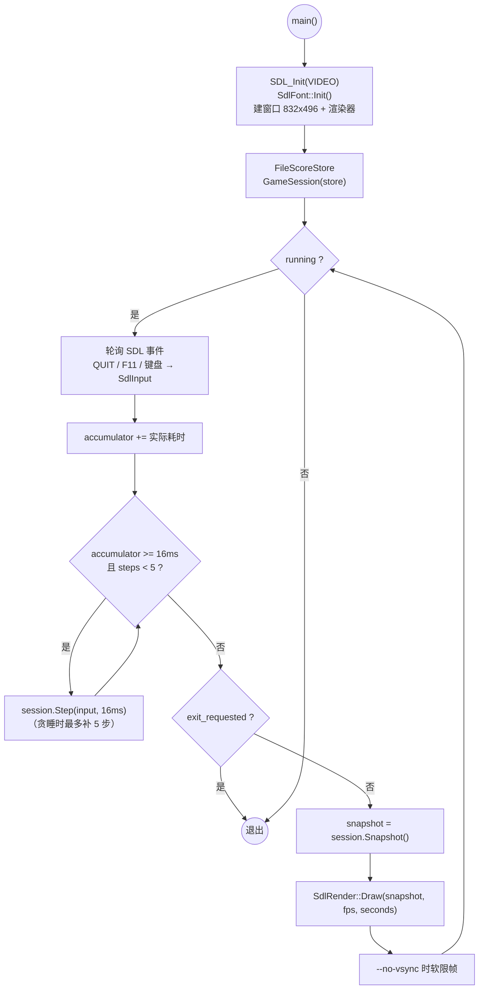
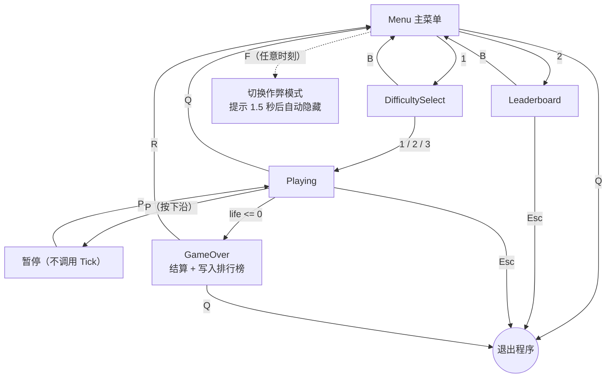
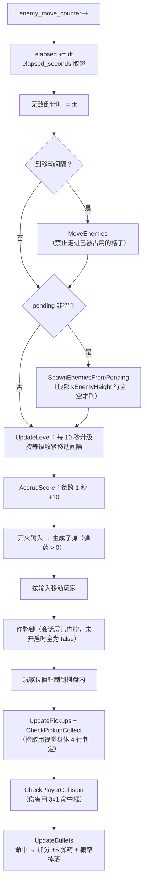
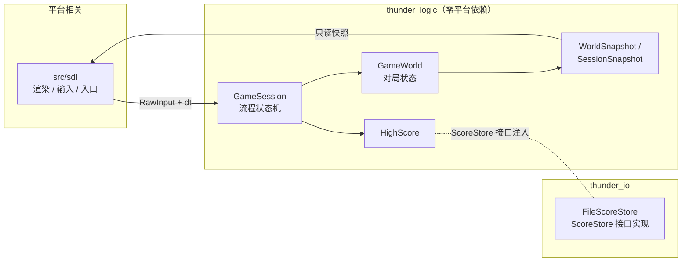

# 运行流程图

描述当前（v1.7，单一 SDL3 前端）的实际执行路径。

## 主循环

## GameSession 状态机

## 一帧的 Tick 顺序（GameWorld::Tick）

## 分层

逻辑层不包含任何 SDL / windows.h / 文件 IO / 系统时钟调用，
由 `tests/check_isolation.cmake` 在 ctest 中强制校验。
